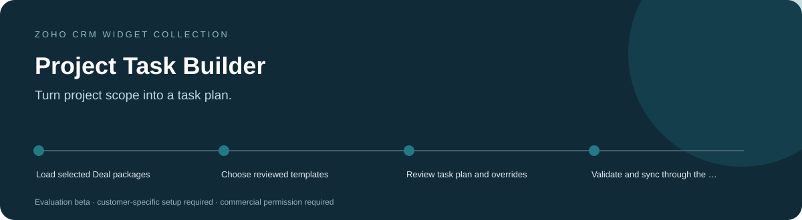
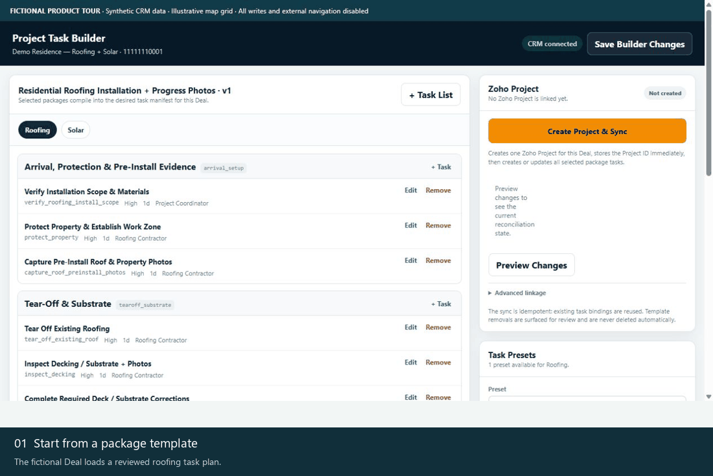
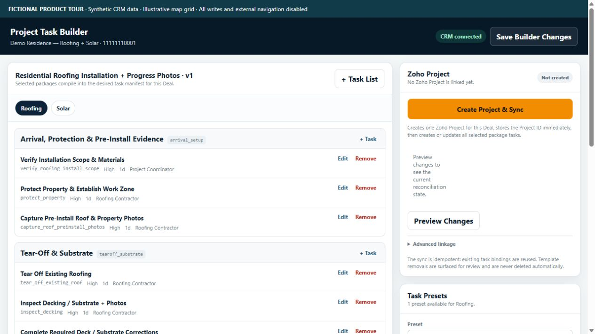
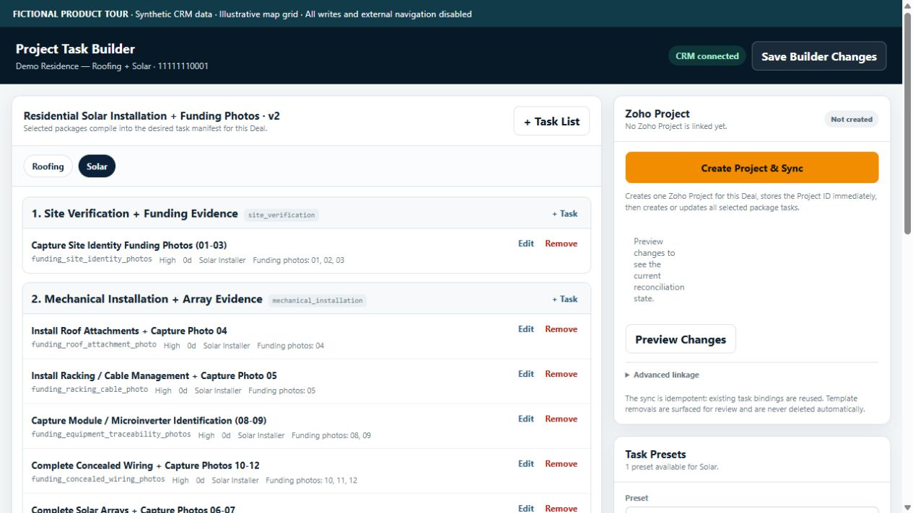
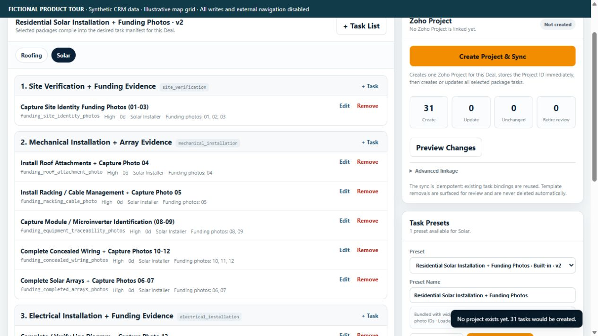
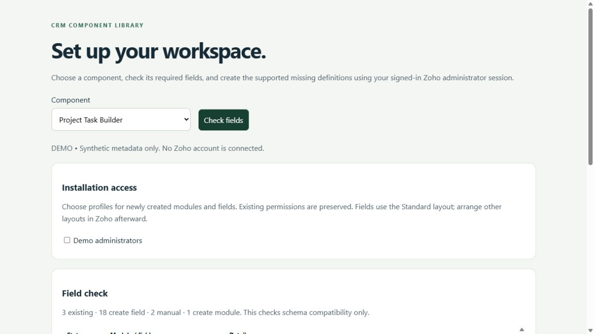

<h1 align="center">Project Task Builder for Zoho CRM</h1>

<strong>Turn project scope into a task plan.</strong> A template-driven Deal workspace for preparing package-specific task plans, reviewing overrides and coordinating a controlled handoff into Zoho Projects.

Tested &amp; In Development / Pre-Release · Development showcase and fictional-data tours

> **Tested & In Development / Pre-Release.** Testing covers documented development checks only. Production readiness and customer-specific acceptance remain pending.

> [!IMPORTANT]
> **Showcase only.** This public repository contains product information and fictional demonstration media. It provides no software source, installable packages, free beta downloads or software license. Release availability remains pending; any future deployment scope will be agreed privately. Product validation and the limitations below still apply.

[Discuss a commercial installation](https://github.com/RawPowered/Zoho-Project-Task-Builder/issues/new?template=commercial-inquiry.yml) · [Deployment model](DEPLOYMENT.md) · [Commercial terms overview](COMMERCIAL.md)

## A focused workspace

Project managers and operations teams turning an approved scope into repeatable work.

| Capability | What it helps with |
| --- | --- |
| **Reusable package templates** | Start from included service templates or manage reviewed presets in CRM. |
| **Deal-specific planning** | Compile selected packages, edit supported overrides and preserve task bindings on the Deal. |
| **Projects handoff** | Inspect project/task context and invoke a separately configured executor for supported sync actions. |

## Product tour

These captures show the actual widget running against an isolated fictional-data adapter. No customer account, real person, customer branding or production credential is used. CRM writes and outbound navigation are blocked. Map backgrounds are illustrative grids; required third-party attribution is retained.

### Watch the workflow

The animation is a sequence of actual interface states, held for readability. It is not a recording of a live customer installation.

### Start with the workspace

The fictional Deal loads a reviewed roofing task plan.

### Follow the next actions

<table><tr><td width="50%"><strong>Switch the project package</strong>
Solar shows its own template phases and tasks.
</td><td width="50%"><strong>Preview the planned changes</strong>
Review prospective task creation before any Projects sync.
</td></tr></table>

### Prepare the account deliberately

A separately licensed Schema Setup companion can be scoped to this product. It reads field metadata, identifies compatible existing definitions, and distinguishes missing definitions from manual steps. A field plan does not certify that functions, workflows or permissions are complete.

All records and sample labels are fictional. Preview tooling and installable software are not distributed through this public showcase. Commercial deployment still requires the documented account-specific acceptance checks.

## Commercial deployment

Licensed widget packages are supplied privately for the agreed customer organization. An authorized administrator installs them directly inside Zoho CRM using **Zoho internal hosting**, sets the supplied entry page and attaches the intended CRM placement. A Deal record related list or button with record context.

Schema, access profiles, workflows and service connections are reviewed for the licensed installation. A showcase screenshot does not certify compatibility or complete those steps. WordPress integration, where licensed, runs on the customer's live WordPress host and is configured separately. [How the platforms fit together](DEPLOYMENT.md).

## Data access and responsibilities

**Reads:** The active Deal, Project_Task_Templates and Projects data accessed through the configured executor.

**Writes:** Save actions can create/update template records and write Deal planning/binding fields. Projects actions call company_projects_executor, which can create or update Projects resources. Those actions require separately configured permissions and connections.

**External services:** Zoho Projects through the company_projects_executor function and customer-managed projects connection.

## Current product boundaries

- A widget upload does not configure the Projects connection or deploy its executor.
- Retry and interrupted-sync behavior must be tested with synthetic projects before production.
- Built-in templates are starting points and require review for the customer's actual delivery process.

Status: **Tested & In Development / Pre-Release**. Account-specific acceptance is required before production activation. Credentials and customer data are configured privately in the customer environment.

## Commercial availability

Request licensing, installation, account mapping or support through a [commercial inquiry](https://github.com/RawPowered/Zoho-Project-Task-Builder/issues/new?template=commercial-inquiry.yml). Include only a general use case; public issues must not contain customer records, account IDs, secrets or confidential details. Pricing, permitted organizations/users, delivery scope and support terms are agreed privately. This page does not collect payment or grant permission to use the software.

## Explore the collection

[Widget collection](https://github.com/RawPowered/Zoho-CRM-Widgets) · [Automation overview](https://github.com/RawPowered/Zoho-CRM-Automations) · [PowerPortals](https://github.com/RawPowered/PowerPortals-Showcase)

- [Service Map](https://github.com/RawPowered/Zoho-Service-Map)
- [Get Directions](https://github.com/RawPowered/Zoho-Get-Directions)
- [Service Map Dashboard](https://github.com/RawPowered/Zoho-Service-Map-Dashboard)
- [CEO Pipeline](https://github.com/RawPowered/Zoho-CEO-Pipeline)
- [Project Scoper](https://github.com/RawPowered/Zoho-Project-Scoper)
- [Parts and Scope Builder](https://github.com/RawPowered/Zoho-Parts-and-Scope-Builder)
- [Financial Scope](https://github.com/RawPowered/Zoho-Financial-Scope)
